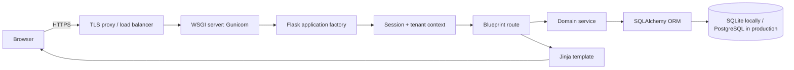
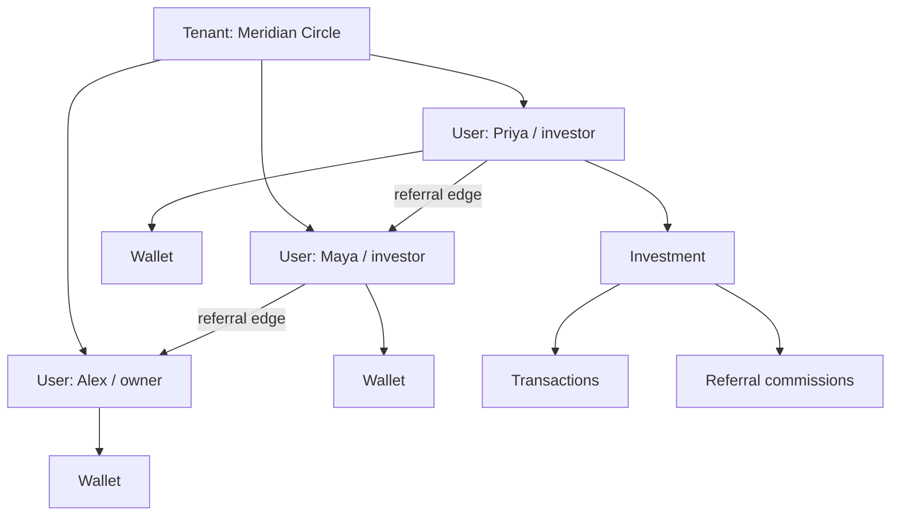
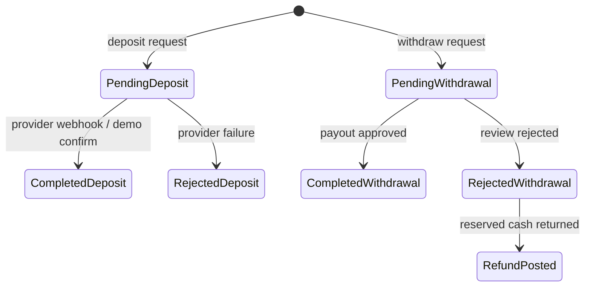
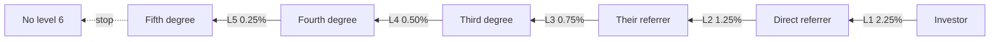

# Architecture notes

Sigma Investments is a server-rendered Flask application. The browser receives
HTML, one local stylesheet, one progressive-enhancement script, and local font
files. There is no SPA build step and no third-party runtime dependency.

## Request path



The application factory (`app/__init__.py`) loads the selected configuration,
applies proxy handling, initialises extensions, registers blueprints, installs
security hooks, and exposes template globals. Routes stay thin: validation and
authorisation happen at the boundary, while ledger mutations live in
`app/services/`.

## Tenant isolation

A **tenant** is a client workspace. It is the isolation boundary for every
financial record.



Rules enforced in code and queries:

- Every `User`, `Wallet`, `Investment`, `Transaction`, `Referral`, and
  `ReferralCommission` row carries `tenant_id`.
- A self-service signup creates a new tenant and makes the user its `owner`.
- A signup with a valid invite code joins the inviter's tenant as an `investor`
  and creates one direct referral edge. This keeps each referral tree inside a
  single ledger.
- Authenticated queries always filter by both `tenant_id == g.user.tenant_id`
  and `user_id == g.user.id` where the row is personal. Cross-tenant object IDs
  resolve to "not found" rather than leaking existence.
- Session identity is re-validated on every request against the user's tenant
  and active status; a stale or tampered session is cleared.

## Data model

| Table | Responsibility | Notable constraints |
| --- | --- | --- |
| `tenants` | Workspace boundary | unique slug, active/suspended status |
| `users` | Identity, role, referral code | globally unique email and code, scrypt hash, tenant FK |
| `wallets` | Integer-cent cash balance | one per user, non-negative available/reserved columns |
| `investments` | Position terms and settlement cursor | plan snapshot, `months_credited`, `next_credit_on`, maturity date |
| `transactions` | Immutable ledger rows | idempotency key unique per tenant, balance snapshot, status |
| `referrals` | One edge per invited user | unique referred user, self-referral blocked |
| `referral_commissions` | Immutable payout audit rows | unique investment/level/beneficiary, links to ledger row |

Money is stored as integer cents. Rates are basis points (1 bps = 0.01%) and
converted with a half-up integer helper, never binary floating point.

## Money flows



A deposit creates a pending row and does not change the available balance. A
confirmed deposit credits the wallet and writes a completed ledger row.

A withdrawal reserves cash immediately (`available` decreases, `reserved`
increases) so the same dollars cannot be invested or withdrawn twice. Approval
settles the reservation; rejection returns it through a separate
`withdrawal_refund` ledger row for a complete audit trail.

Opening an investment debits the wallet and creates an `investment` transaction.
Referral payouts are separate platform-funded credits; the investor's principal
is neither reduced nor used to pay commissions.

## Return settlement

Each investment snapshots its monthly rate and term at purchase time. The
`months_credited` column is the materialised cursor, while
`next_credit_on` drives eligibility.

1. A scheduler calls `credit_due_returns()` (CLI: `flask credit-returns`).
2. The service selects active positions whose `next_credit_on` is due.
3. For each position it credits one month at a time, writes a `return`
   transaction with key `return:<investment>:<month>`, advances the cursor, and
   marks the position `matured` after the final instalment.
4. One commit covers the batch. A retry is safe because the unique idempotency
   key blocks a duplicate month.

Late jobs catch up: the loop continues while the cursor is due, so a scheduler
outage does not silently skip instalments.

## Referral resolution



The service walks direct `referrals` edges upward. A visited set and the
five-iteration cap stop cycles and over-payment. For every new position:

```
commission_cents = round_half_up(principal_cents × rate_bps / 10_000)
```

A unique key `referral:<investment>:<level>:<beneficiary>` makes payout
idempotent. The `referral_commissions` row stores the level, rate, source user,
investment, beneficiary, and ledger transaction so reporting never has to infer
history from mutable data.

## Security boundaries

- Passwords: Werkzeug scrypt, parameterised encoded hashes.
- Browser auth: Flask's signed, HTTP-only, SameSite=Lax session cookie. Session
  fixation is prevented by clearing the session on login; an absolute server-side
  lifetime is checked on each request.
- CSRF: Flask-WTF token on every mutating form; a dedicated error page handles
  expiry.
- Headers: CSP without `unsafe-inline`, frame denial, nosniff, referrer policy,
  permissions policy, COOP, HSTS when HTTPS is detected.
- Rate limits: stricter buckets on login, signup, deposit, withdrawal, invest,
  and demo transitions. Redis is recommended for multi-process deployments.
- Input: WTForms validation plus service-layer re-validation of amounts,
  networks, addresses, plan codes, and ownership.
- Production: the app refuses to boot with a weak secret, missing database URL,
  demo mode, or missing proxy trust. Demo simulation routes return 404 when
  `DEMO_MODE` is off.

## External integration seams

| Concern | Current prototype | Production replacement |
| --- | --- | --- |
| Fiat on-ramp | Pending request + demo confirm | Stripe/Adyen checkout session and signed webhook |
| Crypto deposit | Static display address + demo confirm | Custody provider address assignment and webhook |
| Withdrawal payout | Reservation + demo approve/reject | Provider payout API with idempotency key and status webhook |
| Return scheduler | CLI command | Cron, Celery beat, Cloud Scheduler, or a job runner |
| Rate-limit storage | In-memory | Redis |
| Database | SQLite | PostgreSQL with Alembic migrations |
| Email/notifications | Not included | Transactional email provider hooked to ledger events |

`app/services/payments.py` contains `PaymentProviderStub`, the documented class
where provider clients belong. Webhook handlers must verify the provider
signature before calling the same idempotent service functions used by the demo
controls.
